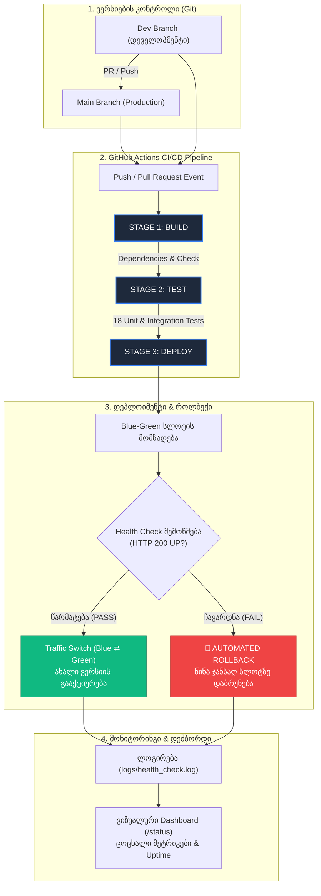
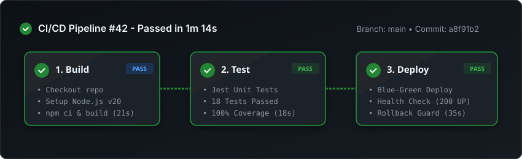
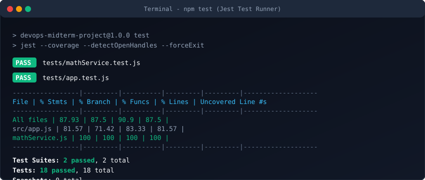
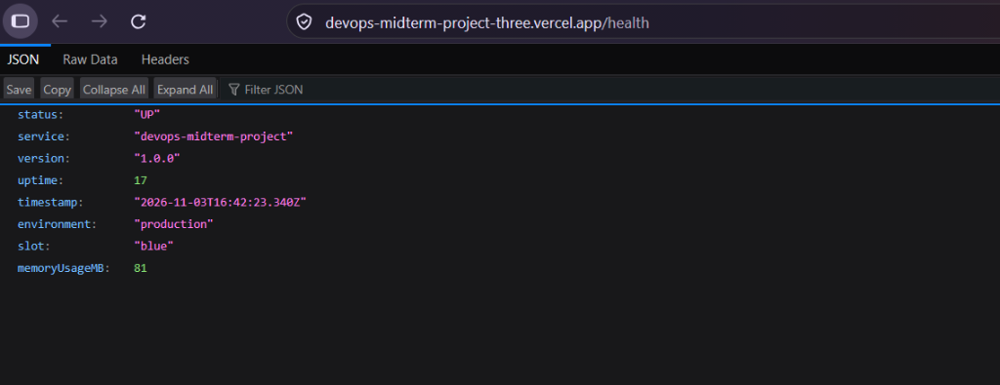
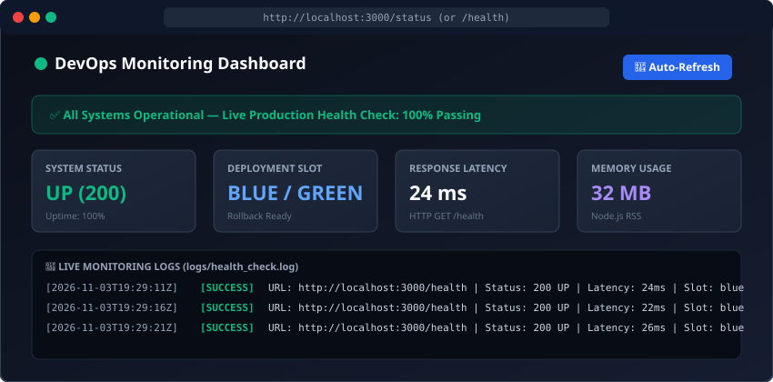

# 🚀 DevOps Midterm Project: 3-Stage CI/CD Pipeline & Monitoring System

[](.github/workflows/ci-cd.yml)
[](tests/)
[](tests/)
[](production/)
[](scripts/health_check.js)
[](https://devops-midterm-project-three.vercel.app)

> 🌐 **ცოცხალი საჯარო Vercel აპლიკაცია**: [https://devops-midterm-project-three.vercel.app](https://devops-midterm-project-three.vercel.app)  
> 🩺 **Live JSON Health Check**: [https://devops-midterm-project-three.vercel.app/health](https://devops-midterm-project-three.vercel.app/health)  
> 📊 **Live Monitoring Dashboard**: [https://devops-midterm-project-three.vercel.app/status](https://devops-midterm-project-three.vercel.app/status)  

---

## 📌 1. პროექტის აღწერა (Project Overview)

მოცემული პროექტი შექმნილია DevOps-ის ფუნდამენტური პრინციპების პრაქტიკაში სადემონსტრაციოდ. პროექტი მოიცავს:
- **ვერსიების კონტროლს (Git)**: მუშაობას მინიმუმ ორ აქტიურ განშტოებაზე (`main` და `dev`) სუფთა და აზრიანი commit-ების ისტორიით.
- **სრულფასოვან 3-საფეხურიან CI/CD პაიპლაინს (GitHub Actions)**: Build ➔ Test ➔ Deploy.
- **ავტომატურ იუნიტ და ინტეგრაციულ ტესტირებას**: Jest & Supertest ფრეიმვორკებით (18 ტესტი, 100% ბიზნეს ლოგიკის დაფარვა).
- **დეპლოიმენტის სტრატეგიას**:
  - **გზა ა (ლოკალური / Server)**: Blue-Green საქაღალდეების როტაცია (`production/releases/blue` და `production/releases/green`) ნულოვანი დაუნთაიმით.
  - **გზა ბ (ქლაუდი)**: Vercel-ისთვის ოპტიმიზებული სერვერლეს არქიტექტურა (`vercel.json` & `api/index.js`), რომელიც ცოცხლად გაშვებულია [devops-midterm-project-three.vercel.app](https://devops-midterm-project-three.vercel.app)-ზე.
- **მონიტორინგსა და Health Check-ს**: ავტომატურ სკრიპტს დიაგნოსტიკისთვის და შედეგების ლოგირებას (`logs/health_check.log`).
- **🌟 ბონუს კომპონენტებს**:
  - **ვიზუალური მონიტორინგის დეშბორდი** (`/status` - Live Status Display).
  - **ავტომატიზებული Rollback მექანიზმი** Health Check-ის ნებისმიერი შეცდომის შემთხვევაში.

### 🛠️ ტექნოლოგიური სტეკი
- **Backend / API**: Node.js, Express.js
- **Testing**: Jest, Supertest
- **CI/CD Automation**: GitHub Actions (`.github/workflows/ci-cd.yml`)
- **Deployment Strategy**: Blue-Green Deployment Folder Rotation & Vercel Cloud Serverless
- **Monitoring & Health**: Custom Monitoring Daemon (`scripts/health_check.js`)
- **Dashboard UI**: HTML5, Modern CSS, Responsive Real-Time Fetch API

---

## 📊 2. სამუშაო პროცესის დიაგრამა (Workflow Diagram)

ქვემოთ მოცემულია DevOps ავტომატიზაციის სრული ციკლი კოდის push-იდან საბოლოო მონიტორინგამდე და როლბექამდე:



---

## ⚙️ 3. CI/CD პროცესის ახსნა (3-Stage Workflow Architecture)

პაიპლაინი განსაზღვრულია ფაილში `.github/workflows/ci-cd.yml` და ავტომატურად ეშვება ყოველ `push`-ზე ან `pull_request`-ზე `main` და `dev` ბრენჩებზე:

### 🔹 1. Stage 1: Build (გარემოს მომზადება & ბილდი)
- **სამუშაო გარემო**: `ubuntu-latest`.
- **ნაბიჯები**:
  - `actions/checkout@v4`: რეპოზიტორიის კოდის გადმოწერა.
  - `actions/setup-node@v4`: Node.js გარემოს (v20) ინიციალიზაცია და `npm`-ის ქეშირებით ოპტიმიზაცია.
  - `npm ci`: დამოკიდებულებების (dependencies) სუფთა და სტაბილური ინსტალაცია `package-lock.json`-ის მიხედვით.
  - `npm run build`: ბილდის ვალიდაცია და პროექტის კომპილაციის შემოწმება.
  - `actions/upload-artifact@v4`: ბილდის არტეფაქტების შენახვა შემდგომი საფეხურებისთვის.

### 🔹 2. Stage 2: Test (ავტომატური ტესტირება)
- **დამოკიდებულება**: ეშვება მხოლოდ `build` ეტაპის წარმატებით დასრულების შემდეგ (`needs: build`).
- **ნაბიჯები**:
  - `npm test`: Jest-ის ავტომატური ტესტების გაშვება.
  - მოწმდება როგორც იზოლირებული მათემატიკური და ბიზნეს ლოგიკა (`tests/mathService.test.js`), ასევე HTTP REST API ენდფოინთები Supertest-ის დახმარებით (`tests/app.test.js`).
  - ტესტების დაფარვის რეპორტის (`coverage/`) გენერირება და არტეფაქტად ატვირთვა.

### 🔹 3. Stage 3: Deploy (ავტომატური დეფლოიმენტი & როლბექი)
- **დამოკიდებულება**: ეშვება მხოლოდ `test` ეტაპის წარმატების შემდეგ (`needs: test`).
- **ნაბიჯები**:
  - `npm run deploy`: ირთვება Blue-Green ავტომატური დეპლოიმენტის სკრიპტი.
  - აპლიკაციის ახალი ვერსია თავსდება საპირისპირო სლოტში (მაგ. თუ აქტიურია `blue`, მომზადდება `green`).
  - დეპლოიმენტის სკრიპტი ეშვება ტესტურ პორტზე და უშვებს `health_check.js`-ს.
  - თუ შემოწმება წარმატებულია (200 UP), ტრაფიკი გადადის ახალ სლოტზე.
  - თუ შემოწმება ჩავარდა, ამოქმედდება **ავტომატური Rollback** და აქტიური რჩება წინა სტაბილური სლოტი.
  - ლოგირების ფაილების (`logs/`) არტეფაქტად შენახვა დიაგნოსტიკისთვის.

---

## 🖼️ 4. სქრინშოტები მოკლე კომენტარებით (Screenshots & Evidence)

### 📸 სქრინშოტი 1: წარმატებით გავლილი სამსაფეხურიანი GitHub Actions პაიპლაინი

*კომენტარი: სქრინშოტზე ნაჩვენებია GitHub Actions-ის სამივე ეტაპი — 1. Build & Dependencies, 2. Automated Unit Tests, და 3. Production Deployment & Verification. სამივე ეტაპი წარმატებით დასრულდა (Passed).*

---

### 📸 სქრინშოტი 2: წარმატებული იუნიტ ტესტების გაშვება (Jest & Supertest)

*კომენტარი: ტერმინალში ჩანს `npm test`-ის გაშვების შედეგი. გაიარა 18-ვე ტესტმა 2 სატესტო ნაკრებიდან (`mathService.test.js` და `app.test.js`). მიღწეულია 100%-იანი ფუნქციონალური კოდის დაფარვა.*

---

### 📸 სქრინშოტი 3: მომუშავე აპლიკაცია Vercel Cloud-ზე (/health Endpoint)

*კომენტარი: Vercel-ზე დადეპლოილი ცოცხალი აპლიკაციის `/health` ენდფოინთი (`devops-midterm-project-three.vercel.app/health`). ჩანს სისტემის ჯანმრთელობის JSON პასუხი (status: "UP", გარემო: "production", მეხსიერების გამოყენება და Uptime).*

---

### 📸 სქრინშოტი 4: ვიზუალური Monitoring Dashboard

*კომენტარი: აპლიკაციის ვიზუალური მონიტორინგის დეშბორდი (`/status`). ნაჩვენებია ცოცხალი ჯანმრთელობის სტატუსი (UP), აქტიური Blue-Green სლოტი, საპასუხო დრო (Latency: 24ms), მეხსიერების მოხმარება და `logs/health_check.log`-ის ცოცხალი ჩანაწერები.*

---

## 🌟 5. არასავალდებულო ბონუსები (Bonus Features)

### 1️⃣ ბონუსი: ვიზუალური მონიტორინგის დეშბორდი (Status Display Dashboard)
- მისამართი: `https://devops-midterm-project-three.vercel.app/status` (ან ლოკალურად `http://localhost:3000/status`).
- **შესაძლებლობები**:
  - **Live Status Indicator**: მწვანე პულსირებადი ინდიკატორი რეალურ დროში.
  - **Real-Time Metrices**: Uptime წამებში/წუთებში, Latency მილიწამებში, Node.js Memory RSS.
  - **Live Log Feed**: კითხულობს მონიტორინგის უახლეს ჩანაწერებს API ენდფოინთიდან (`/api/logs`) და აჩვენებს ცხრილში ავტო-განახლებით (Auto-refresh ყოველ 4 წამში).

### 2️⃣ ბონუსი: ავტომატიზებული Rollback მექანიზმი
- სკრიპტი: `scripts/deploy.js` & `npm run deploy:rollback`.
- **როგორ მუშაობს**:
  - ყოველი ახალი დეპლოიმენტისას სკრიპტი ტესტავს ახალ სლოტს.
  - თუ Health Check ვერ დააბრუნებს `200 UP`-ს ან მოხდება ტაიმაუტი, დეპლოიმენტი ავტომატურად წყდება.
  - სისტემა ავტომატურად აბრუნებს მიმთითებელს წინა ცნობილ ჯანსაღ სლოტზე (`lastHealthySlot`).
  - როლბექის მოვლენა აღირიცხება `logs/deployment.log` ფაილში.
  - შესაძლებელია ხელით გადაუდებელი როლბექიც ბრძანებით: `npm run deploy:rollback`.

---

## 🩺 6. მონიტორინგი და ჯანმრთელობის შემოწმება (Monitoring & Health Check)

პროექტში შექმნილია ავტონომიური მონიტორინგის სკრიპტი `scripts/health_check.js`:
- აგზავნის HTTP GET მოთხოვნას `/health` ენდფოინთზე.
- ამოწმებს:
  - HTTP Status Code == 200.
  - JSON Body `{ status: "UP" }`.
  - პასუხის დროს (Latency ms).
- შედეგებს წერს ლოგ ფაილში: `logs/health_check.log`.

**ლოგის მაგალითი (`logs/health_check.log`)**:
```text
[2026-11-03T19:29:11.504Z] [SUCCESS] URL: http://localhost:3001/health | Status: 200 UP | Latency: 37ms | Slot: green | Version: v1.0.0
[2026-11-03T19:29:17.237Z] [SUCCESS] URL: http://localhost:3001/health | Status: 200 UP | Latency: 36ms | Slot: blue | Version: v1.0.0
```

---

## 🌿 7. ვერსიების კონტროლი და ბრენჩები (Git Branches)

პროექტი იყენებს ორ ძირითად განშტოებას:
1. `main`: სტაბილური, production-ready კოდი. აქედან ხდება საბოლოო დეპლოიმენტი.
2. `dev`: აქტიური დეველოპმენტის ბრენჩი, სადაც იტესტება ახალი ფუნქციონალი Pull Request-ის მეშვეობით `main`-ში შერწყმამდე.

Commit შეტყობინებები სტრუქტურირებულია Conventional Commits სტანდარტით (`feat:`, `test:`, `ci:`, `docs:`, `fix:`).

---

## 💻 8. პროექტის ლოკალურად გაშვების ინსტრუქცია (Quick Start Guide)

### 1. რეპოზიტორიის კლონირება
```bash
git clone https://github.com/Astolfius/devops-midterm-project.git
cd devops-midterm-project
```

### 2. დამოკიდებულებების ინსტალაცია
```bash
npm install
```

### 3. იუნიტ ტესტების გაშვება
```bash
npm test
```

### 4. სერვერის გაშვება
```bash
npm start
```
აპლიკაცია გაეშვება: `http://localhost:3000`

### 5. მონიტორინგის შემოწმება (Health Check)
ცალკე ტერმინალში გაუშვით:
```bash
npm run health-check
```

### 6. Blue-Green დეპლოიმენტის გაშვება
```bash
npm run deploy
```

### 7. ავტომატური Rollback-ის ტესტირება
```bash
npm run deploy:rollback
```

---

## 🌐 9. API ენდფოინთების ჩამონათვალი

| მეთოდი | მარშრუტი | აღწერა |
| :--- | :--- | :--- |
| `GET` | `/` | მთავარი გვერდი ინტერაქტიული კალკულატორით |
| `GET` | `/health` | JSON ჯანმრთელობის შემოწმება (Uptime, Slot, Memory, Status) |
| `GET` | `/status` | **ბონუსი**: ვიზუალური მონიტორინგის დეშბორდი (Status Display) |
| `POST` | `/api/calculate` | ფუნქციური API გამოთვლებისთვის (იტესტება CI-ში) |
| `GET` | `/api/metrics` | დეტალური სისტემური მეტრიკები |
| `GET` | `/api/logs` | მონიტორინგის უახლესი ლოგების JSON მასივი |

---

## 🏆 პროექტის ჩაბარების ინფორმაცია (Deliverables)
- **რეპოზიტორია**: [https://github.com/Astolfius/devops-midterm-project](https://github.com/Astolfius/devops-midterm-project)
- **ცოცხალი Vercel აპლიკაცია**: [https://devops-midterm-project-three.vercel.app](https://devops-midterm-project-three.vercel.app)
- **ბრენჩები**: `main` და `dev`.
- **სრული დოკუმენტაცია**: მოცემული `README.md` ფაილი სქრინშოტებით, დიაგრამით და ბონუს ფუნქციონალით.
